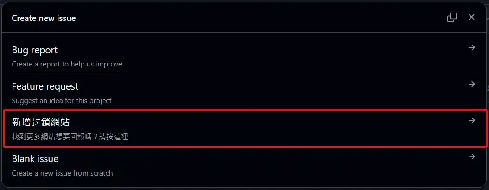

# 台灣 DNS 封鎖列表

歡迎光臨台灣 DNS 封鎖列表，在這邊你可以將以下網址放入 Adguard, uBlock Origin 等擋廣告或是 DNS 程式！

https://raw.githubusercontent.com/blusewill/taiwan-dns-fliter/refs/heads/master/filter.txt

即可阻擋詐騙/釣魚/博弈網站！

## 怎麼運作？

這個 Repo 會有機器人每個月 2 號去抓取 165 官方的資料庫！

分別是：

[165反詐騙諮詢專線_假投資(博弈)網站](https://data.gov.tw/dataset/160055)

[165反詐騙諮詢專線_遭停止解析涉詐網站](https://data.gov.tw/dataset/176455)

## 我找到了一個詐騙/釣魚/博弈網站！我要怎麼新增

你可以透過 Issues 裡面的模板來新增詐騙網站

這邊有設定 Github Action 會檢測看看網站是否已經被封鎖

如果還沒有的話，會再經過人工方式來查看！

## 如何支持這個專案

你可以在 GitHub 專案的右上角按一顆星星！

或是可以小額斗內到我的 Ko-Fi 平臺喔！

